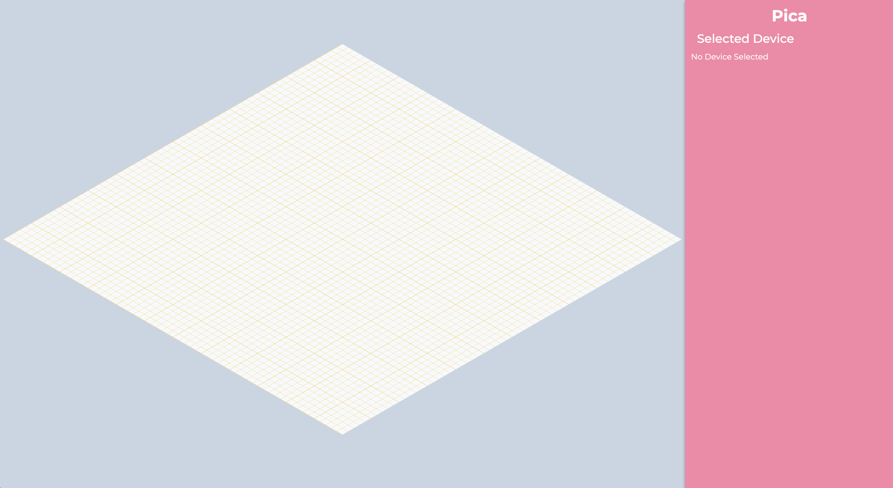

[](https://crates.io/crates/pica)
[](https://github.com/google/pica/actions/workflows/build_and_test.yml?query=branch%3Amain)
[](LICENSE)


# Pica

Pica is a virtual [Ultra-Wideband (UWB)](https://en.wikipedia.org/wiki/Ultra-wideband) subsystem and spatial simulator implementing the **FiRa UCI 2.0** specification.

With it, you can scale testing of UWB software without physical devices.
While Pica aims to be high-fidelity, it does _not_ simulate low-level radio behavior.

## Why Pica?

- Uses the same protocol (UCI) that UWB chips do
- Supports a user-defined distance and angle model
- Deterministic, repeatable simulation (no internal randomness)
- Powers UWB in the Android Emulator

## Feature Roadmap

✅ Supported · ⏳ Planned · ➖ Not planned · ❌ Out of scope

### FiRa

| Feature | Release | Status |
| :--- | :--- | :--- |
| Two-Way Ranging (TWR) | 1.x | ✅ |
| Angle of Arrival (AoA) | 1.x | ✅ |
| Device Test Mode | 1.x | ❌ |
| Downlink TDoA (DL-TDoA) | 2.0 | ✅ |
| Data Transfer | 2.0 | ✅ |
| One-Way AoA (OWR AoA) | 2.0 | ⏳ |
| Contention-based ranging (ESS-TWR, ADS-TWR) | 2.0 | ➖ |
| Uplink TDoA (UL-TDoA) | 2.0 | ➖ |
| Hybrid UWB Scheduling (HUS) | 3.0 | ➖ |
| Dedicated data transfer | 3.0 | ⏳ |
| Logical Link data exchange | 3.0 | ⏳ |
| Downlink TDoA v2 | 4.0 | ⏳ |

### Industry Profiles

| Profile | Version | Status |
| :--- | :--- | :--- |
| [CCC Digital Key](https://carconnectivity.org/digital-key/) | 3.0 | ✅ |
| [Aliro](https://csa-iot.org/all-solutions/aliro/) | 1.0 | ✅ |

## Language Support

- **Rust**: Use the `pica` crate.
- **C/C++**: Build `pica` with the `ffi` feature.
- **Python**: The `pica` package in `py/pica` connects to a running Pica server.

## Playground and Tests

Run the web playground, then open `http://127.0.0.1:3000`. UWB software connects on TCP port `7000`. To save packet captures, add `-- --pcapng-dir <DIR>`.

```bash
git clone https://github.com/google/pica.git && cd pica
cargo run --bin pica-http
```



Run the tests:

```bash
cargo build
cargo test --features ffi
pip install ./py/pica/ 'pytest==7.4.4' 'pytest-asyncio==0.23.3'
pytest -v
```
